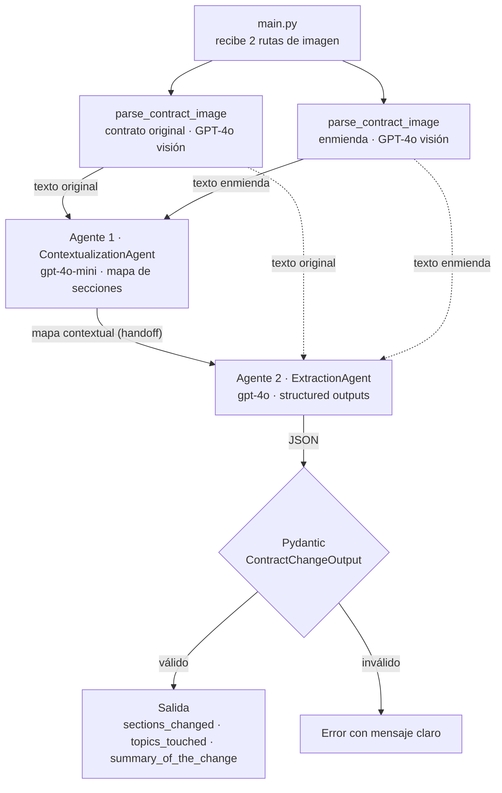

# Agente de Comparación de Contratos

Sistema multiagente que recibe las **imágenes escaneadas** de un contrato y su enmienda,
las lee con IA de visión y devuelve un **JSON validado** con los cambios legales,
con trazabilidad completa de cada paso en Langfuse.

Proyecto Integrador del Módulo 4 de la especialización AI Engineering (Henry).

## El problema

En **LegalMove**, el equipo de Compliance dedica más de 40 horas por semana a comparar
a mano contratos con sus enmiendas para identificar qué cambió. El proceso es lento,
propenso a errores e impide escalar.

## Resultados

| Métrica                                     | Valor                                     |
| ------------------------------------------- | ----------------------------------------- |
| Cambios detectados en los 3 casos de prueba | **14 de 14 (100%)**, sin falsos positivos |
| Tiempo por comparación                      | ~9 segundos                               |
| Costo por comparación                       | ~USD 0,02                                 |

Detalle de los casos y cambios esperados: [`data/test_contracts/README.md`](data/test_contracts/README.md).

## Arquitectura



1. **Parsing multimodal:** GPT-4o transcribe cada imagen a texto conservando la jerarquía
   de cláusulas. Las dos imágenes se procesan **en paralelo**.
2. **Agente 1 (Analista Legal Senior):** compara la _estructura_ de ambos textos y arma un
   mapa de qué sección corresponde a cuál. No busca cambios.
3. **Agente 2 (Auditor Legal):** usa el mapa y los dos textos para detectar cada
   **adición, eliminación y modificación**.
4. **Validación:** el resultado debe cumplir el schema `ContractChangeOutput` de Pydantic.

### Trazabilidad en Langfuse

Cada ejecución genera una traza con esta jerarquía:

```
contract-analysis                  ← span raíz: rutas de entrada y resultado final
├── parse_original_contract        ← generation: imagen → texto
├── parse_amendment_contract       ← generation: imagen → texto
├── contextualization_agent        ← generation: textos → mapa
└── extraction_agent               ← generation: mapa + textos → JSON
```

Cada paso registra input, output, modelo, tokens, latencia y costo.

## Estructura del proyecto

```
src/
├── main.py                        # Punto de entrada: orquesta el flujo y la traza
├── config.py                      # Parámetros (modelos, límites, timeouts)
├── image_parser.py                # Validación, base64 y llamada multimodal
├── models.py                      # Schema Pydantic ContractChangeOutput
├── agents/
│   ├── contextualization_agent.py # Agente 1
│   └── extraction_agent.py        # Agente 2
└── prompts/
    ├── vision.py                  # Prompt de transcripción
    ├── contextualization.py       # System prompt del Agente 1
    └── extraction.py              # System prompt del Agente 2
data/test_contracts/               # 3 pares de prueba + cambios esperados
```

## Stack

- **OpenAI GPT-4o (visión)**: lectura de las imágenes.
- **LangChain**: orquestación de los dos agentes.
- **Pydantic**: validación del resultado.
- **Langfuse**: trazabilidad del flujo.
- **Python + python-dotenv**: lenguaje base y manejo seguro de credenciales.

Versiones fijadas en `requirements.txt` (probado con Python 3.14).

## Instalación

```bash
git clone https://github.com/JCesarAguilar/contract-comparison-agent.git
cd contract-comparison-agent
python3 -m venv .venv
source .venv/bin/activate
pip install -r requirements.txt
cp .env.example .env
```

Completa `.env` con tus claves:

- `OPENAI_API_KEY`: desde platform.openai.com.
- `LANGFUSE_PUBLIC_KEY` y `LANGFUSE_SECRET_KEY`: crea un proyecto en cloud.langfuse.com.
- `LANGFUSE_HOST`: la URL de tu región de Langfuse.

## Uso

```bash
python -m src.main <imagen_contrato_original> <imagen_enmienda>
```

Ejemplo (caso 3):

```bash
python -m src.main data/test_contracts/documento_3__original.jpg data/test_contracts/documento_3__enmienda.jpg
```

Salida:

```json
{
  "sections_changed": [
    "3. Precio",
    "4. Disponibilidad del Servicio",
    "5. Soporte"
  ],
  "topics_touched": [
    "Precio",
    "Disponibilidad del Servicio",
    "Soporte al Cliente"
  ],
  "summary_of_the_change": "[MODIFICACIÓN] 3. Precio: \"...USD 1.200.\" → \"...USD 1.250.\"\n..."
}
```

La traza completa queda disponible en Langfuse, en **Tracing**.

## Decisiones técnicas

**Visión con GPT-4o en lugar de OCR.** Un LLM multimodal lee y entiende el documento en un
solo paso y conserva la estructura de cláusulas. Con OCR + LLM, un error de lectura se
arrastra al resto del flujo sin posibilidad de corrección. Se usa `detail="high"` para
leer letra chica y `temperature=0` para una transcripción estable.

**Dos agentes en lugar de uno.** Separación de responsabilidades: el Agente 1 ordena la
estructura y el Agente 2 se dedica solo a encontrar diferencias. Cada uno tiene un rol y un
system prompt especializados, y en Langfuse se puede auditar qué produjo cada uno.

**El mapa del Agente 1 es texto, no JSON.** Es un resultado intermedio que lee otro LLM, así
que se controla con un formato Markdown fijo definido en el prompt. Solo se valida con
Pydantic la salida final, que es la que consumen otros sistemas.

**Structured outputs + Pydantic.** El Agente 2 usa `with_structured_output` de LangChain: la
API de OpenAI restringe la generación al schema y Pydantic valida la respuesta, incluida una
regla propia (el resumen no puede estar vacío). El schema define _qué_ es cada campo; el
prompt define _cómo_ llenarlo.

**Prompts separados de la lógica.** Cada agente importa su propio system prompt desde
`src/prompts/`. Así se puede ajustar un prompt sin tocar el código. Los secretos viven en
`.env` y los parámetros en `config.py`.

**Manejo de errores.** Validación de la imagen de entrada (existencia, formato, tamaño),
timeout de 60 s con 3 reintentos automáticos, errores de la API agrupados por la acción que
requieren (credenciales, fallas temporales, errores del servicio), detección de respuestas
cortadas y mensajes claros en todos los casos.

**Observabilidad.** Cada llamada a un modelo se registra como _generation_ con su modelo y
tokens, lo que permite ver el costo por paso. Del parsing se registra la ruta de la imagen y
no su contenido en base64, para no cargar la traza con datos pesados.

## Iteración guiada por evidencia

**Prompts ajustados con los casos de prueba:**

- El Agente 1 clasificaba la enmienda como "modificación parcial" porque se guiaba por el
  título del documento. Se reemplazó por una regla basada en la estructura. Importa porque,
  en una enmienda parcial, una sección ausente no es una eliminación.
- El Agente 2 detectaba 5 de 6 cambios en el caso 1: omitía que la licencia dejaba de ser
  "intransferible". Se le pidió reportar todas las diferencias de cada sección y citar las
  frases completas. Resultado: 6 de 6.

**Optimización medida en Langfuse (caso 1):**
| Versión | Cambio | Latencia | Costo |
|---|---|---|---|
| 1 | Base: todo con GPT-4o, en secuencia | 14,5 s | USD 0,0255 |
| 2 | Agente 1 con gpt-4o-mini (tarea simple; −94% en ese paso) | 12,8 s | USD 0,0202 |
| 3 | Parsing de ambas imágenes en paralelo (asyncio) | **8,7 s** | **USD 0,0204** |

Resultado: **−40% de latencia y −20% de costo**, con la misma calidad. El Agente 2 mantiene
GPT-4o porque la precisión en cambios legales sutiles es crítica.

## Limitaciones y mejoras futuras

- Procesa una imagen por documento (JPG o PNG). Los contratos de varias páginas o en PDF
  requerirían convertir y unir las páginas.
- Ocasionalmente el texto citado por el Agente 2 omite un espacio entre palabras. No afecta
  la detección de cambios.
- El texto de los contratos queda registrado en Langfuse. Con documentos confidenciales en
  producción convendría enmascarar datos sensibles.
- Próximos pasos: evaluación automatizada contra los casos de prueba y tests con pytest.

## Autor

Julio César Aguilar
